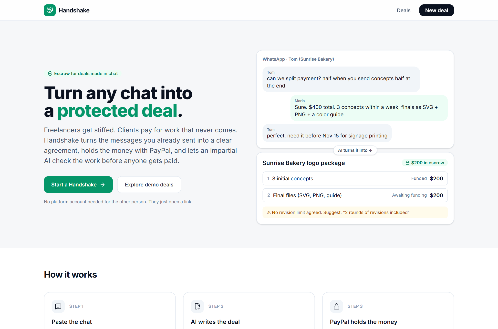
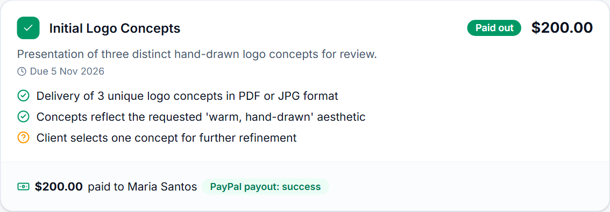
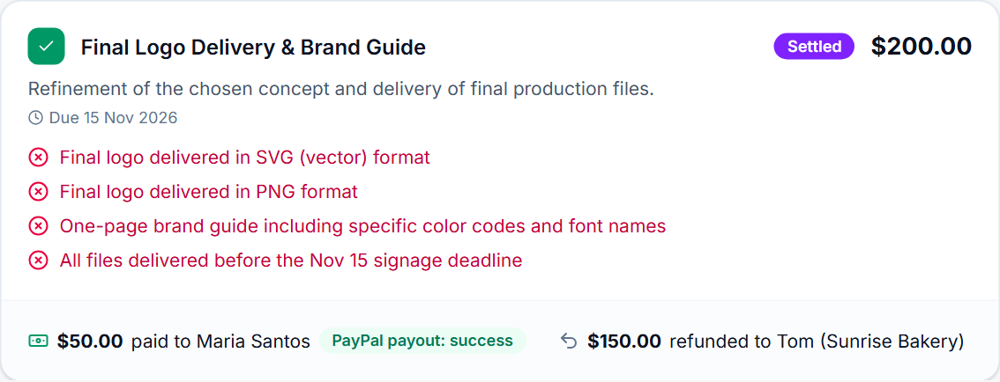
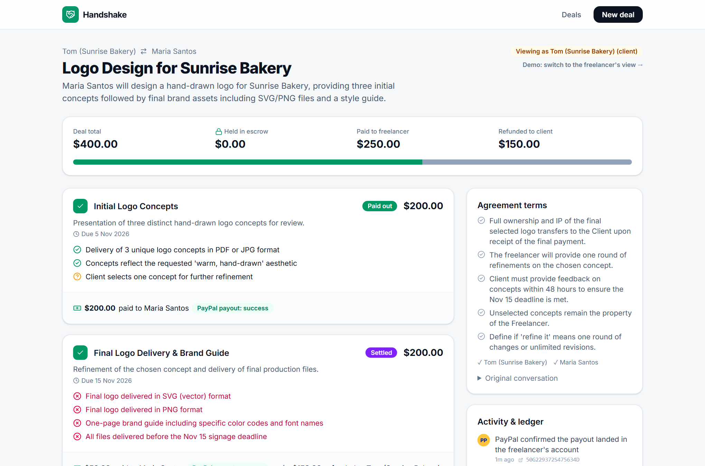

# Handshake: turn any chat into a protected deal

**AI-drafted milestone escrow on PayPal.** Paste the WhatsApp/DM/email thread where you agreed on a job. Gemini turns it into a clear milestone agreement, the client funds each milestone through PayPal, an AI Verifier checks the delivered work against the agreed criteria, and the money is released with PayPal Payouts. If the parties disagree, an AI Mediator proposes a fair split, and once both accept, Handshake executes it as a PayPal payout plus a partial refund.

> Built for the *Build What's Next with PayPal and AI* hackathon. Everything runs on the PayPal **sandbox**; no real money moves.

**Demo video:** _add your YouTube link here_



| AI Delivery Verifier | AI Mediator settlement |
|---|---|
|  |  |



## The problem

Millions of people do paid work on a handshake: a freelance designer and a bakery owner in another country, a handyman found in a neighborhood group, a tutor, a video editor hired over Instagram DMs. The "contract" is a few chat messages. That's how it goes wrong:

- **Freelancers don't get paid**, or get paid late, after delivering.
- **Clients pay upfront** and get late, partial or no work.
- **Nobody can say who's right**, because the scope was never written down.

Marketplaces only protect deals made inside them and take a large cut. Traditional escrow is built for houses and domain names, not $400 logo jobs.

## What Handshake does

| Step | What happens | PayPal | AI |
|---|---|---|---|
| 1. Paste the chat | Text or screenshots of the conversation | | **Agreement Drafter** extracts parties, milestones, amounts, due dates and *testable* acceptance criteria, and flags gaps that cause disputes (no revision limit, vague scope, IP not mentioned) |
| 2. Both sign | Each party opens a private link and signs | | |
| 3. Fund escrow | Client funds a milestone | **Orders v2** (create, approve, capture), or **Invoicing v2** as an alternative | |
| 4. Deliver | Freelancer submits notes, links, files and photos | | **Delivery Verifier** checks every criterion against the evidence (vision for images, fetched page text for links) and writes a per-criterion report |
| 5. Release | Client approves, or silence after a passing check auto-releases after 72h | **Payouts v1** to the freelancer's PayPal account, with status sync | |
| 6. Disagree? | Either side freezes funds and gives their side | | **Mediator** weighs the agreement, verification report and both statements, and proposes a % split with reasoning tied to the terms |
| 7. Settle | Both parties accept the split | **Payouts** for the freelancer's share + partial **Refund** (Payments v2) of the rest to the client | |

**Design rule: AI advises, people decide.** The AI never moves money on its own. Funds move only when the client approves, the review window lapses after a passing verification, or both parties accept a settlement.

Every state change and PayPal call is written to a per-deal **activity ledger** showing PayPal order, capture, refund and payout IDs.

## Run it locally (about 5 minutes)

Requirements: **Node.js 22.13+** (uses the built-in `node:sqlite`, so nothing native to compile).

```bash
git clone <this repo>
cd handshake
npm install
cp .env.example .env      # then fill it in (see below)
npm run dev               # http://localhost:3000
```

### Keys

1. **Gemini** (free): create a key at <https://aistudio.google.com> → *Get API key*, and put it in `GEMINI_API_KEY`.
2. **PayPal sandbox**: at <https://developer.paypal.com> (Sandbox):
   - *Testing Tools → Sandbox Accounts*: create one **Business** and two **Personal** accounts, **Country: United States** (non-US sandbox business accounts may be refused by the Payouts API).
   - *Apps & Credentials → Create App*, linked to that Business account. Copy the Client ID and Secret into `PAYPAL_CLIENT_ID` / `PAYPAL_CLIENT_SECRET`.
   - Put one Personal account in `SANDBOX_CLIENT_EMAIL` (it pays) and the other in `SANDBOX_FREELANCER_EMAIL` (it gets paid).

**No PayPal keys, or keys that stopped working?** Leave them blank (or let them fail: Handshake checks them at startup) and Handshake runs in **simulation mode**: the same product, with a clearly labelled stand-in for PayPal's approval page and `-SIM-` transaction IDs in the ledger. Add keys to switch to the real sandbox.

### Try the whole flow

1. Go to **New deal**, click **Try: Logo design**, then **Draft agreement with AI**. Review the AI draft, add a gap as a term, and click **Sign**.
2. Click **Demo: switch to the client's view** (demo mode lets one browser play both sides), then **Sign agreement**.
3. **Fund with PayPal**: log in with the client sandbox account and pay. You return with the money captured into escrow.
4. Switch to the freelancer and submit work (add an image to see vision-based checking). Watch the **AI Verifier** report appear.
5. As the client, either **Approve & release** (PayPal payout) or **Open a dispute**, then add the other side's statement, **Ask the AI Mediator**, and accept the split from both sides. A payout and a refund execute.
6. Log into <https://www.sandbox.paypal.com> as the freelancer or client to see the money arrive.

### Automated end-to-end test

With the server running and sandbox logins in `.env` (`SANDBOX_CLIENT_PASSWORD` too):

```bash
npm run e2e            # headless; add -- --headed to watch
```

It drafts a deal with the AI, signs as both parties, **pays through the real PayPal sandbox checkout**, submits work, runs AI verification, disputes, mediates, settles (refund) and funds the next milestone.

## Architecture

```
web/ (React + Vite + Tailwind)        server/ (Node + Express, TypeScript via tsx)
  Landing, New deal (AI draft review)    index.ts   REST API, PayPal return URL, webhooks
  Deal page (escrow, verify, mediate)    engine.ts  deal state machine; every money movement
  Deals directory (demo)                 paypal.ts  Orders v2, Payments v2 refunds, Payouts v1,
                                                    Invoicing v2, webhook signature verification
                                         ai.ts      Gemini agents with JSON-schema structured output
                                         db.ts      SQLite (node:sqlite): deals, milestones,
                                                    submissions, disputes, ledger events
```

Milestone states: `AWAITING_FUNDING → FUNDED → SUBMITTED → RELEASED`, or `→ DISPUTED → SETTLED`, or `→ REFUNDED`.

Engineering notes:
- **Idempotency:** every money-moving PayPal call sends a `PayPal-Request-Id`; a per-milestone lock prevents double releases.
- **Redirect approval flow:** orders use `payment_source.paypal.experience_context` with return/cancel URLs. If the payer closes the tab, the `CHECKOUT.ORDER.APPROVED` webhook still captures the order.
- **Webhooks:** `POST /api/webhooks/paypal`, verified through `/v1/notifications/verify-webhook-signature` (set `PAYPAL_WEBHOOK_ID`). Handles order approval, invoice paid and payout success.
- **Payout status sync:** a background job polls payout batches until PayPal reports `SUCCESS`.
- **Prompt-injection hygiene:** evidence and statements are passed to the models as data, and the prompts tell them never to follow instructions inside them.
- **Resilient AI on a free tier:** requests rotate across several Gemini Flash models and skip any that is rate-limited or overloaded.

## AI and tools used

| Tool | How it's used |
|---|---|
| **Google Gemini API** (Gemini 3.x Flash family) | Three agents with structured JSON output: **Agreement Drafter** (chat text + screenshots → milestone contract and risk flags), **Delivery Verifier** (multimodal: images + fetched link text → per-criterion verdicts), **Mediator** (agreement + evidence + statements → split proposal with cited reasoning) |
| **PayPal Orders v2** | Create, approve (redirect) and capture escrow funding per milestone |
| **PayPal Payments v2** | Full and partial refunds of captures (cancellation and mediated settlements) |
| **PayPal Payouts v1** | Release escrowed funds to the freelancer, with batch status polling |
| **PayPal Invoicing v2** | Alternative funding: send the client a PayPal invoice for a milestone |
| **PayPal Webhooks** | Signature-verified event handling |
| **Playwright** | End-to-end test through the real PayPal sandbox checkout; records the demo video |

## Production path

The sandbox demo holds funds in the platform's PayPal business account and pays out with Payouts. In production this would move to **PayPal's multiparty / marketplace capabilities** (seller onboarding, delayed disbursement, platform fees), with KYC on both sides, a human appeals tier above the AI Mediator, and PayPal **Disputes API** integration that automatically submits the agreement, verification report and ledger as evidence.

## Configuration reference

See [`.env.example`](.env.example). Notable options: `AUTO_RELEASE_HOURS` (default 72), `DEMO_MODE` (default on: role switcher and deal directory), `PAYPAL_MODE=mock` (force simulation), `PAYOUTS_FALLBACK=simulate` (label payouts as simulated if your sandbox region can't send Payouts), `GEMINI_MODELS` (comma-separated model rotation).

## License

[MIT](LICENSE)
